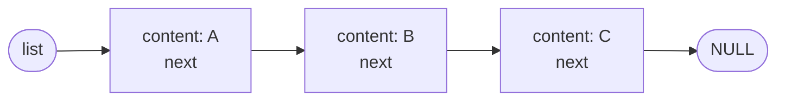

*This project has been created as part of the 42 curriculum by gbaccell.*

<div align="center">

# 📚 Libft

**Your very first own library — a hand-written C standard library for the 42 Common Core.**


</div>

---

## 📖 Table of Contents

- [Description](#-description)
- [The Library](#-the-library)
  - [Part 1 — Libc functions](#part-1--libc-functions)
  - [Part 2 — Additional functions](#part-2--additional-functions)
  - [Part 3 — Linked lists](#part-3--linked-lists)
- [Instructions](#-instructions)
- [Usage Example](#-usage-example)
- [Technical Choices](#-technical-choices)
- [Resources](#-resources)

---

## 🧭 Description

**Libft** is the first project of the 42 Common Core. The goal is to re-implement a set of functions from the C standard library (`libc`), plus a series of extra utilities for strings, memory, output and linked lists, and to package them all into a static library: **`libft.a`**.

Beyond producing a reusable toolbox for future 42 projects, Libft is about understanding *how* these functions really work under the hood:

- 🧠 **Memory** — raw bytes, `void *`, overlapping regions, `malloc` / `free`
- 🔤 **Strings** — null-termination, buffer sizes, safe copying and concatenation
- 🔗 **Data structures** — building and freeing singly linked lists
- 🛠️ **Tooling** — writing a `Makefile`, creating a static library with `ar`, and following the 42 **Norm**

All functions are prefixed with `ft_` and behave like their originals as described in their `man` pages.

---

## 🧩 The Library

### Part 1 — Libc functions

Re-implementations of standard `libc` functions, with the same prototypes and behaviour.

#### Character checks & conversion

| Function | Description |
|---|---|
| `int ft_isalpha(int c)` | Checks for an alphabetic character |
| `int ft_isdigit(int c)` | Checks for a digit (`0`–`9`) |
| `int ft_isalnum(int c)` | Checks for an alphanumeric character |
| `int ft_isascii(int c)` | Checks whether `c` fits in the ASCII table (0–127) |
| `int ft_isprint(int c)` | Checks for a printable character, space included |
| `int ft_toupper(int c)` | Converts a lowercase letter to uppercase |
| `int ft_tolower(int c)` | Converts an uppercase letter to lowercase |

#### Memory

| Function | Description |
|---|---|
| `void *ft_memset(void *s, int c, size_t n)` | Fills `n` bytes of memory with the byte `c` |
| `void ft_bzero(void *s, size_t n)` | Sets `n` bytes of memory to zero |
| `void *ft_memcpy(void *dest, const void *src, size_t n)` | Copies `n` bytes (regions must not overlap) |
| `void *ft_memmove(void *dest, const void *src, size_t n)` | Copies `n` bytes, safe for overlapping regions |
| `void *ft_memchr(const void *s, int c, size_t n)` | Finds the first byte `c` in `n` bytes of memory |
| `int ft_memcmp(const void *s1, const void *s2, size_t n)` | Compares `n` bytes of two memory areas |
| `void *ft_calloc(size_t nmemb, size_t size)` | Allocates zero-initialised memory for an array |

#### Strings

| Function | Description |
|---|---|
| `size_t ft_strlen(const char *s)` | Returns the length of a string |
| `size_t ft_strlcpy(char *dst, const char *src, size_t dstsize)` | Size-bounded string copy, always null-terminated |
| `size_t ft_strlcat(char *dst, const char *src, size_t dstsize)` | Size-bounded string concatenation |
| `char *ft_strchr(const char *s, int c)` | Finds the **first** occurrence of a character |
| `char *ft_strrchr(const char *s, int c)` | Finds the **last** occurrence of a character |
| `int ft_strncmp(const char *s1, const char *s2, size_t n)` | Compares at most `n` characters of two strings |
| `char *ft_strnstr(const char *big, const char *little, size_t len)` | Finds a substring within the first `len` characters |
| `int ft_atoi(const char *nptr)` | Converts a string to an `int` |
| `char *ft_strdup(const char *s)` | Returns a newly allocated copy of a string |

---

### Part 2 — Additional functions

Functions that are either not in the `libc`, or exist there in a different form.

#### String manipulation (allocate a new string)

| Function | Description |
|---|---|
| `char *ft_substr(char const *s, unsigned int start, size_t len)` | Extracts a substring of at most `len` characters starting at `start` |
| `char *ft_strjoin(char const *s1, char const *s2)` | Concatenates `s1` and `s2` into a new string |
| `char *ft_strtrim(char const *s1, char const *set)` | Removes the characters of `set` from both ends of `s1` |
| `char **ft_split(char const *s, char c)` | Splits `s` into a `NULL`-terminated array of words, using `c` as delimiter |
| `char *ft_itoa(int n)` | Converts an `int` to a string (handles negatives and `INT_MIN`) |
| `char *ft_strmapi(char const *s, char (*f)(unsigned int, char))` | Builds a new string by applying `f` to each character |
| `void ft_striteri(char *s, void (*f)(unsigned int, char *))` | Applies `f` to each character of `s`, in place |

#### Output to a file descriptor

| Function | Description |
|---|---|
| `void ft_putchar_fd(char c, int fd)` | Writes a character |
| `void ft_putstr_fd(char *s, int fd)` | Writes a string |
| `void ft_putendl_fd(char *s, int fd)` | Writes a string followed by a newline |
| `void ft_putnbr_fd(int n, int fd)` | Writes an integer |

> 💡 A **file descriptor** is a number that identifies where output goes: `1` is the standard output, `2` is the standard error, and any file opened with `open()` gets its own number.

---

### Part 3 — Linked lists

Functions to create and manipulate singly linked lists, built on this structure (declared in `libft.h`):

```c
typedef struct s_list
{
	void			*content;
	struct s_list	*next;
}	t_list;
```

Each node stores a pointer to **any kind of data** (`void *content`) and the address of the **next node**. The last node points to `NULL`:



| Function | Description |
|---|---|
| `t_list *ft_lstnew(void *content)` | Creates a new node |
| `void ft_lstadd_front(t_list **lst, t_list *new)` | Adds a node at the **beginning** of the list |
| `void ft_lstadd_back(t_list **lst, t_list *new)` | Adds a node at the **end** of the list |
| `unsigned int ft_lstsize(t_list *lst)` | Counts the nodes in the list |
| `t_list *ft_lstlast(t_list *lst)` | Returns the last node of the list |
| `void ft_lstdelone(t_list *lst, void (*del)(void *))` | Frees **one** node and its content |
| `void ft_lstclear(t_list **lst, void (*del)(void *))` | Frees **every** node, then sets the list to `NULL` |
| `void ft_lstiter(t_list *lst, void (*f)(void *))` | Applies `f` to the content of every node |
| `t_list *ft_lstmap(t_list *lst, void *(*f)(void *), void (*del)(void *))` | Builds a **new** list by applying `f` to every content |

---

## ⚙️ Instructions

### Requirements

- A C compiler (`cc`)
- `make`
- `ar` (part of GNU binutils)

### Compilation

Clone the repository and build the library:

```bash
git clone git@github.com:GTitonele/libft-42porto.git
cd libft-42porto
make
```

This compiles every source file with `-Wall -Wextra -Werror` and creates **`libft.a`** at the root of the repository.

### Makefile rules

| Rule | Action |
|---|---|
| `make` / `make all` | Builds `libft.a` |
| `make clean` | Removes the object files (`.o`) |
| `make fclean` | Removes the object files **and** `libft.a` |
| `make re` | Runs `fclean`, then rebuilds everything |

The `Makefile` does not relink: running `make` twice in a row does nothing the second time.

### Using the library in your own project

1. Include the header in your source files:

   ```c
   #include "libft.h"
   ```

2. Link against `libft.a` when compiling:

   ```bash
   cc -Wall -Wextra -Werror main.c -L. -lft -o my_program
   ```

   - `-L.` tells the linker to look for libraries in the current directory
   - `-lft` links `libft.a` (the `lib` prefix and `.a` extension are implied)

---

## 🚀 Usage Example

```c
#include "libft.h"

int	main(void)
{
	char	**words;
	int		i;

	words = ft_split("hello  42  porto", ' ');
	if (words == NULL)
		return (1);
	i = 0;
	while (words[i])
	{
		ft_putendl_fd(words[i], 1);
		free(words[i]);
		i++;
	}
	free(words);
	return (0);
}
```

```console
$ cc main.c -L. -lft -o demo && ./demo
hello
42
porto
```

---

## 🧱 Technical Choices

- **One function per file**, as required by the subject. Helper functions are declared `static`, so they are only visible inside their own file (e.g. `count_words`, `free_all` and `fill_words` in `ft_split.c`).
- **Reusing the library inside itself** — later functions are built on earlier ones: `ft_strtrim` and `ft_split` use `ft_substr`, `ft_strjoin` uses `ft_strlcpy` / `ft_strlcat`, `ft_calloc` uses `ft_bzero`, and `ft_lstmap` uses `ft_lstnew`, `ft_lstadd_back` and `ft_lstclear`.
- **`unsigned char` for byte comparisons** — `ft_memcmp`, `ft_strncmp` and `ft_memchr` read bytes as `unsigned char`, so values above 127 compare correctly.
- **`long` to handle `INT_MIN`** — `ft_atoi`, `ft_itoa` and `ft_putnbr_fd` use a `long` internally, because `-(-2147483648)` does not fit in an `int`.
- **Overflow-safe `ft_calloc`** — `nmemb * size` is checked against `SIZE_MAX` *before* multiplying, and a request of size `0` returns a unique pointer that can be passed to `free()`, as the subject requires.
- **No memory leaks on failure** — if an allocation fails halfway through `ft_split` or `ft_lstmap`, everything allocated so far is freed before returning `NULL`.

---

## 📚 Resources

### Documentation

- The Linux manual pages: `man 3 strlen`, `man 3 memmove`, `man 3 strlcpy`, `man 3 calloc`, `man 2 write`, …
- [The GNU C Library Reference Manual](https://www.gnu.org/software/libc/manual/)
- [cppreference — C standard library](https://en.cppreference.com/w/c)
- [BSD `strlcpy` / `strlcat` man page](https://man.openbsd.org/strlcpy.3)
- [The 42 Norm (norminette)](https://github.com/42School/norminette)
- [GNU Make Manual](https://www.gnu.org/software/make/manual/make.html)
- [Linked list — Wikipedia](https://en.wikipedia.org/wiki/Linked_list)

### Use of AI

AI (Claude, by Anthropic) was used throughout this project as a **tutor and reviewer**, following the 42 guidelines on AI as a learning tool. Specifically:

- **Explanations of concepts** — function prototypes, `size_t` vs `int`, `const`, pointer casts, `void *`, function pointers, file descriptors, `malloc` / `free`, double pointers (`t_list **`) and linked lists.
- **Guided exercises** — for most functions, the AI provided an explanation and a skeleton with blanks; the functions were then written by me and reviewed.
- **Testing and review** — the AI compiled each function, tested it against the original `libc` functions, checked for memory errors and leaks (AddressSanitizer, valgrind) and pointed out Norm issues. Fixes were then applied by me.
- **Code written or corrected by the AI, at my request**, then explained line by line:
  - `ft_substr` and `ft_split` (except the `count_words` helper) — written by the AI
  - `ft_lstnew` — function body written by the AI
  - `ft_calloc` — full function shown by the AI and typed by me
  - `ft_strncmp`, `ft_strjoin` and `ft_itoa` — corrections applied by the AI

All of the code was studied until I could explain it myself.
